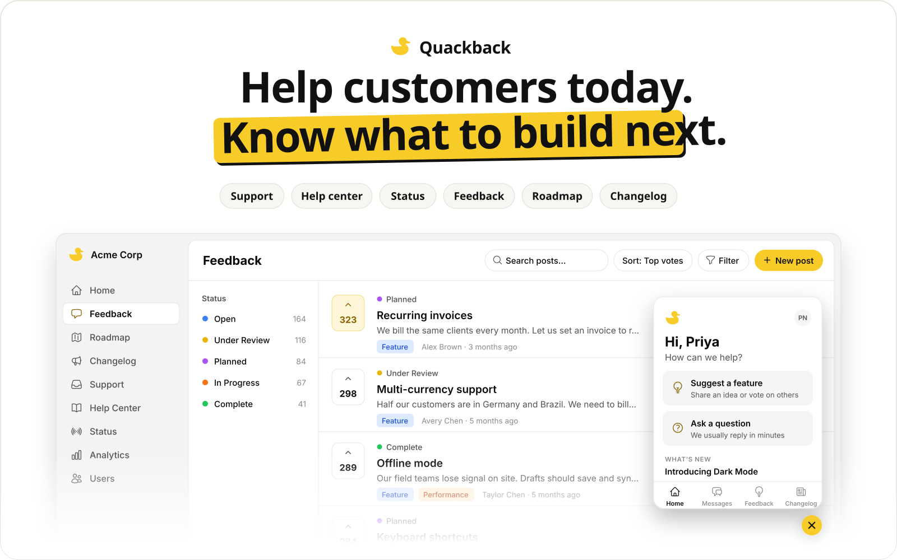
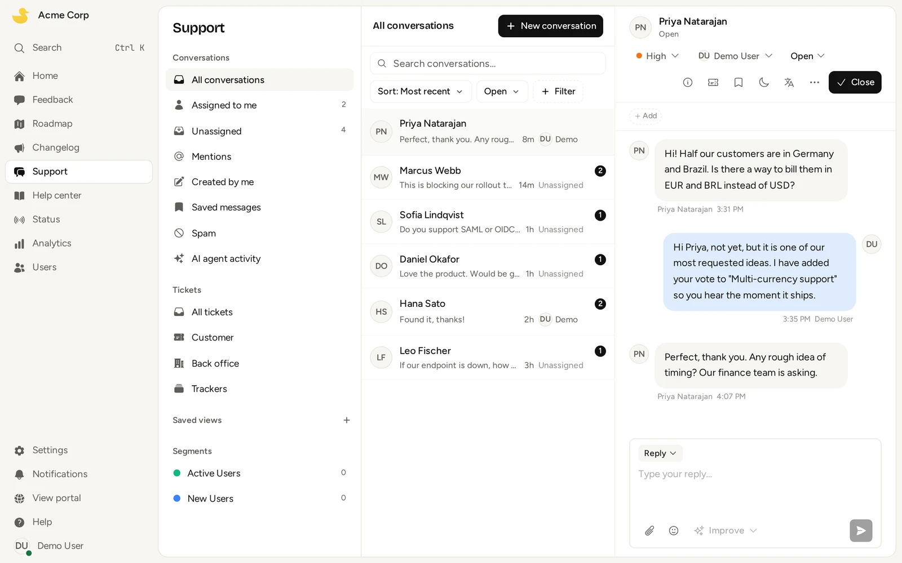
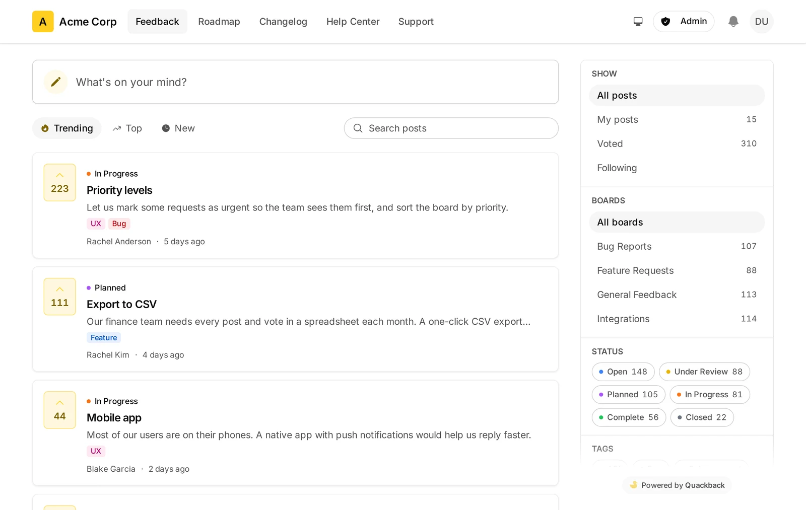

<p align="center">
  <a href="https://quackback.io?utm_source=github&utm_medium=readme">
    <picture>
      <source media="(prefers-color-scheme: dark)" srcset=".github/readme/hero-dark.svg" />
      
    </picture>
  </a>
</p>

<p align="center">
  <strong>Open-source customer support and feedback.</strong><br />
  An alternative to Intercom, Zendesk, Canny and UserVoice.<br />
  Live chat, tickets, a help center and a status page, beside your feedback board, roadmap and changelog. Quackback AI works across all of it. Host it with us or on your own servers.
</p>

<p align="center">
  <a href="https://app.quackback.io/signup?plan=pro&from=github-readme-top&utm_source=github&utm_medium=readme"></a>
  &nbsp;
  <a href="https://railway.com/deploy/quackback?referralCode=ez8Slg&utm_source=github&utm_medium=readme&utm_campaign=deploy-button-top"></a>
</p>

<p align="center">
  <a href="https://quackback.io/demo?utm_source=github&utm_medium=readme">Product tour</a> &middot;
  <a href="https://feedback.quackback.io">Our live board</a> &middot;
  <a href="#self-host">Self-host with Docker</a> &middot;
  <a href="https://quackback.io/compare?utm_source=github&utm_medium=readme">Compare</a> &middot;
  <a href="https://feedback.quackback.io/hc">Docs</a> &middot;
  <a href="https://quackback.io?utm_source=github&utm_medium=readme">Website</a>
</p>

<p align="center">
  <a href="https://github.com/QuackbackIO/quackback"></a>
  <a href="https://github.com/QuackbackIO/quackback/blob/main/LICENSE"></a>
  <a href="https://github.com/QuackbackIO/quackback/actions/workflows/ci.yml"></a>
  <a href="https://github.com/QuackbackIO/quackback/commits/main"></a>
  <a href="https://github.com/QuackbackIO/quackback/releases"></a>
</p>

<p align="center"><sub>Over 250 active instances, self-hosted and on Cloud.</sub></p>

## Why Quackback

- **One product instead of a stack.** Your support desk and your feedback board share the same customers, the same team and the same sign-in.
- **Close the loop.** A support chat becomes a vote on a feature request in one click. When the feature ships, every customer behind it is told, whether they voted on the board or mentioned it in a chat.
- **Open source, and complete.** AGPL-licensed. Self-host with every feature, including single sign-on and the audit log, unlimited seats and no license key.
- **AI built in.** Quackback AI answers customers and drafts replies for your team, and an MCP server lets your own AI tools work with your feedback and tickets.

<picture>
  <source media="(prefers-color-scheme: dark)" srcset=".github/readme/inbox-dark.webp" />
  
</picture>

## What's inside

Use all of it or only the parts you need. Setup asks which, and you can switch more on later in Settings > General > Modules.

### For support teams

- **[Inbox](https://quackback.io/features/inbox?utm_source=github&utm_medium=readme).** Live chat, email and tickets in one shared inbox, with assignment, macros, SLAs and workflows.
- **[Quackback AI](https://quackback.io/features/ai?utm_source=github&utm_medium=readme).** Answers customers from your help center and hands over to a person when it should. Copilot drafts replies for your team.
- **[Help center](https://quackback.io/features/help-center?utm_source=github&utm_medium=readme).** A searchable knowledge base on your own domain and inside the widget.
- **[Status page](https://quackback.io/features/status?utm_source=github&utm_medium=readme).** Incidents, maintenance and uptime history, with email updates.

### For product teams

- **[Feedback boards](https://quackback.io/features/feedback?utm_source=github&utm_medium=readme).** Customers post ideas, vote and comment. Duplicates are caught as they type and merge with their votes.
- **[Roadmap](https://quackback.io/features/roadmap?utm_source=github&utm_medium=readme).** Show what's planned and in progress. Send requests to Linear, Jira or GitHub, and their status keeps up as the issue moves.
- **[Changelog](https://quackback.io/features/changelog?utm_source=github&utm_medium=readme).** Publish updates, link the requests they ship, and every voter gets an email.

<picture>
  <source media="(prefers-color-scheme: dark)" srcset=".github/readme/portal-dark.webp" />
  
</picture>

### For developers

- **[One widget](https://quackback.io/features/widget?utm_source=github&utm_medium=readme).** Chat, feedback, help articles and your changelog in one embed. The [web SDK](packages/widget) is MIT-licensed, with SDKs for [iOS](https://github.com/QuackbackIO/quackback-ios) and [Android](https://github.com/QuackbackIO/quackback-android).
- **[API and webhooks](https://quackback.io/features/api?utm_source=github&utm_medium=readme).** A REST API with an OpenAPI spec, and signed webhooks.
- **[MCP server](#connect-your-ai-tools)**, so AI tools can work in Quackback.
- **[25 integrations](#integrations)**, from Linear and Jira to Slack, HubSpot and Zapier.

### For IT and security

- **Small footprint.** PostgreSQL is the only database, with no Redis or queue to run. It needs as little as 1 CPU core and 1 GB of RAM.
- **[Single sign-on and roles](https://quackback.io/features/sso?utm_source=github&utm_medium=readme).** Your own OIDC provider, custom roles and an audit log. Free when you self-host, Enterprise on Cloud.
- **Your data.** Self-hosted, it stays in your own database. Export it through the API at any time.

**Your brand, their language.** Your own domain and branding, in 13 languages.

## Get started

**Which one?** Choose Cloud to be running today with no servers to look after. Self-host when your data must stay on your own infrastructure, or you want unlimited seats and your own AI provider.

### Quackback Cloud

[Start a free trial](https://app.quackback.io/signup?plan=pro&from=github-readme-get-started&utm_source=github&utm_medium=readme): 14 days of Pro, no card needed. We host, back up and update it, and one flat price per workspace includes your team's seats. See [pricing](https://quackback.io/pricing?utm_source=github&utm_medium=readme).

### Self-host

Every feature, unlimited seats, no license key. You run the servers and bring your own email and AI providers.

[](https://railway.com/deploy/quackback?referralCode=ez8Slg&utm_source=github&utm_medium=readme&utm_campaign=deploy-button)

Or use Docker Compose, which starts Quackback, PostgreSQL and file storage on one host:

```bash
git clone https://github.com/QuackbackIO/quackback.git
cd quackback
cp .env.prod.example .env   # fill in every value
docker compose -f docker-compose.prod.yml up -d
```

Migrations run on startup. The [self-hosting guide](deploy/self-hosted/README.md) covers upgrades, reverse proxies and scaling, and the [configuration reference](docs/configuration.md) lists every variable.

### Moving from another tool

[Import](https://quackback.io/features/import-export?utm_source=github&utm_medium=readme) posts from a CSV in Settings, with a preview before anything is written. The [import CLI](scripts/import/README.md) also brings comments and votes.

## Connect your AI tools

Every instance serves an MCP server at `/api/mcp`, so agents like Claude and Cursor can search, triage and act on feedback, tickets, the changelog and help articles. Sign in with OAuth from your client:

```bash
claude mcp add --transport http quackback https://feedback.yourcompany.com/api/mcp
```

Setup for other clients is in the [MCP docs](https://feedback.quackback.io/hc/en/articles/74-mcp-server). To have a coding agent add the widget to your app, use our [agent skills](https://github.com/QuackbackIO/skills).

## Integrations

| Kind            | Tools                                                                                            |
| --------------- | ------------------------------------------------------------------------------------------------ |
| Issue trackers  | Linear, GitHub, GitLab, Jira, Azure DevOps, Asana, ClickUp, Shortcut, Trello, Monday.com, Notion |
| Chat and alerts | Slack, Microsoft Teams, Discord, ntfy                                                            |
| Support and CRM | Zendesk, Intercom, Freshdesk, HubSpot, Salesforce, Stripe                                        |
| Automation      | Zapier, Make, n8n, Segment, webhooks                                                             |

Each has a setup guide in the [docs](https://feedback.quackback.io/hc/en/collections/11-integrations).

## Community

If Quackback is useful to you, a star helps others find it. To hear about new versions, watch the repo for releases.

- Ask questions and share ideas in [Discussions](https://github.com/QuackbackIO/quackback/discussions)
- See and vote on what's being asked for on [our own board](https://feedback.quackback.io), which runs on Quackback
- Report bugs in [Issues](https://github.com/QuackbackIO/quackback/issues)

## Contributing

The [Contributing Guide](CONTRIBUTING.md) covers local setup (Bun and Docker), demo data and how we work.

### Built with

[TanStack Start](https://tanstack.com/start) and [TanStack Router](https://tanstack.com/router), [PostgreSQL](https://www.postgresql.org/) (which also runs the job queue) with [Drizzle ORM](https://orm.drizzle.team/), [Better Auth](https://www.better-auth.com/), [Tailwind CSS](https://tailwindcss.com/) with [shadcn/ui](https://ui.shadcn.com/), and [Bun](https://bun.sh/).

<a href="https://github.com/QuackbackIO/quackback/graphs/contributors">
  
</a>

## Security and privacy

See [security.md](docs/security.md) for how data is handled. Report vulnerabilities to security@quackback.io or through a [private advisory](https://github.com/QuackbackIO/quackback/security/advisories/new), not in public issues.

Self-hosted instances send one anonymous usage snapshot a day, never content or anything identifying. [telemetry.md](docs/telemetry.md) lists every field, and `DISABLE_TELEMETRY=true` turns it off.

**Cloud code.** Quackback Cloud runs this same code. Its plan and billing checks stay off unless an instance is configured for Cloud, so a self-hosted instance gets every feature, shows no upgrade prompts and never calls our billing service.

## License

[AGPL-3.0](LICENSE). Self-hosting is free. If you run a modified version as a service or distribute it, publish your changes under the AGPL. Contributions need a signed [CLA](CLA.md).

The widget SDK ([`@quackback/widget`](packages/widget)) is [MIT](packages/widget/LICENSE), so you can embed it in closed-source apps.
